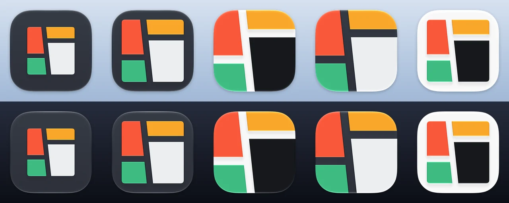
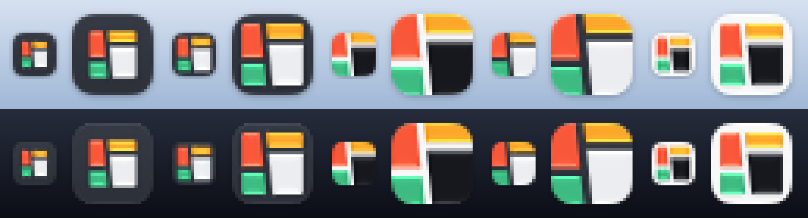
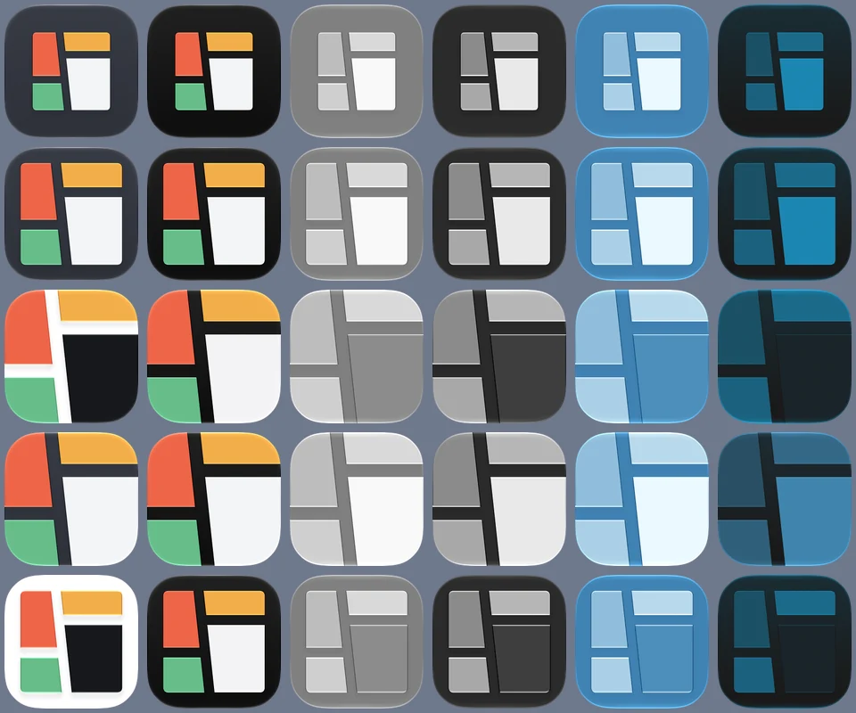
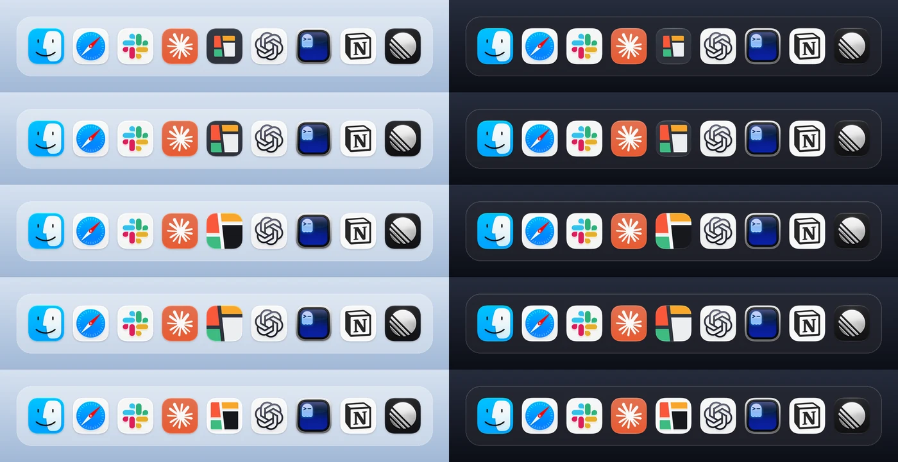
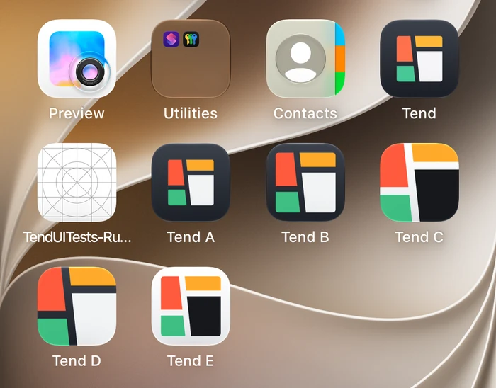
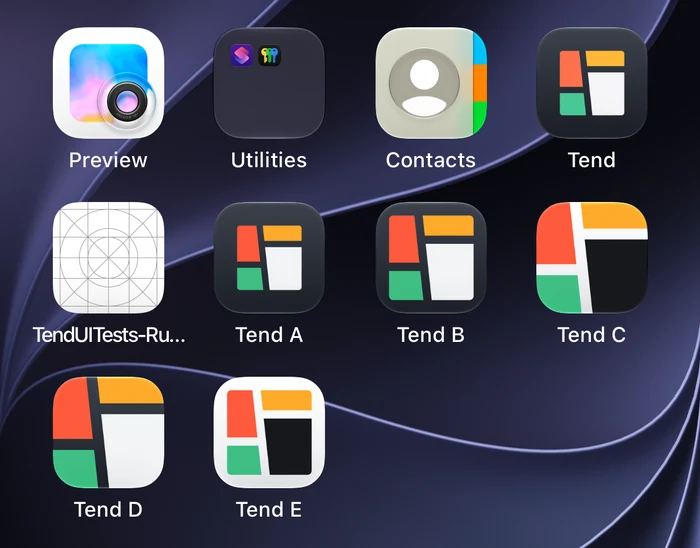

# The Tend app icon: how much padding, and what to do about it

Status: proposal (wave 6, 2026-11-16). Nothing shipped changes until the
owner picks a variant. The picked variant is applied to every platform in
one PR, with the assets regenerated by `scripts/brand/tend_icons.py`.

The complaint: the icon has far too much padding (the gap between the
background and the four-room square in the middle is large), and it looks
poor on the Mac. The owner's idea: the square without a background.

## Owner decision

| Decision | Recommendation | Default meanwhile |
| --- | --- | --- |
| Which variant ships on macOS, iOS, the landing page and in the brand files | **B**: same graphite plate, mark enlarged from 58% to 76% of the icon. D if you want the "no background" look. | A (today's icon) stays. The draft PR for B is ready to merge. |

## Measurements

### Method

macOS draws Tend's icon from an Icon Composer bundle
(`apps/tend-macos/Resources/AppIcon.icon`), so a measurement of the source
SVG is not what you see. Every macOS number here is taken from the system's
own rendering. `actool` compiles the bundle into a throwaway app, and
NSWorkspace draws that app's icon (`scripts/brand/render-app-icon.swift`),
which is how Finder and the Dock draw Tend.app. The pipeline was checked by
rendering the shipped bundle this way: the result is pixel-identical to the
installed `/Applications/Tend.app` icon.

On each 1024 px rendering, `tend_icons.py measure` finds the **plate** from
the opaque pixels. It finds the **glyph** as every pixel that differs (by
more than 40 of 255 in any channel) from the plate colour sampled 3.5% in
from the plate's edge on the same row, so vertical gradients do not count as
glyph. It reports the glyph's larger side as a fraction of the plate, and
the smallest margin.

### Tend today, per platform

| Surface | Asset | Ground | Mark / icon | Margin per side |
| --- | --- | --- | --- | --- |
| macOS app icon (Dock, Finder, Launchpad) | `AppIcon.icon`, the system draws it | graphite squircle, 80.5% of the canvas (the same as every app) | **58.7% of the plate** | **20.6%** |
| iOS / iPadOS app icon | `AppIcon-1024.png`, opaque, the system masks it | graphite, full canvas | **58.0%** | **21.0%** |
| Landing page "Mac app" tile | `landing/mac-icon.webp` | n/a | n/a: **still the pre-rebrand Muxa logo** | n/a |
| `assets/icon.svg`, `appicon-states.svg/-1024.png` | flat copies of the app icon | graphite rounded rect | 58% | 21% |
| macOS menu bar | `BrandMark.swift`, 16 pt box in a 24 pt bar | none | 100% of its box | 0 |
| Web favicon, dashboard header | `dashboard/web/icon.svg` | none | 100% | 0 |
| Windows tray (32 px) and window icon (64 px) | `crates/tend-app/src/mark.rs` (branch `feat/windows-app`) | none | 100% | 0 |
| Windows `.exe` icon | none embedded | n/a | Explorer shows the generic exe icon | n/a |

The complaint is about the **app icon on macOS and iOS** (and the flat
copies of it). The menu bar, favicon and Windows tray already draw the bare
mark edge to edge: they already are "the square without a background".

### Against the platform and the owner's Dock

Apple's macOS grid puts the squircle at 824 of 1024 px (80.5%), which the
system rendering confirms for every app. Apple does not prescribe a glyph
size inside it, so the reference is the apps around Tend, drawn by macOS and
measured the same way:

| App | Glyph / plate | Margin |
| --- | --- | --- |
| Terminal | 41.7% | 19.2% |
| Crest | 60.6% | 18.4% |
| **Tend (today)** | **58.7%** | **20.6%** |
| Slack | 70.1% | 14.9% |
| Claude | 72.3% | 13.7% |
| OrbStack | 74.0% | 13.0% |
| Notion | 75.2% | 12.4% |
| Linear | 75.4% | 11.4% |
| ChatGPT | 79.5% | 10.1% |
| Xcode | 79.9% | 7.6% |
| Safari, Chrome | 80.1% | 10.0% |
| System Settings | 80.8% | 9.6% |

(Finder, Ghostty and Notes are full-bleed artwork, 84-90%, and are left out
of the median.)

**Verdict: the mark is undersized.** The median glyph-on-plate icon in the
owner's Dock spans 77.5% of its plate (Linear 75.4% and ChatGPT 79.5% either
side of it), and Tend's spans 58.7%: **24% smaller across, 43% less area**. Its margin of 20.6% per side is the largest of any
app measured except Terminal's lone prompt. Because the mark is a dense
filled square, the plate reads as a thick frame around it.

On iOS the shipped PNG has the same 58% / 21% geometry. In the simulator's
home screen it is visibly the smallest glyph on the page (see below).

## Variants

All five come from one geometry, the room outlines shared with
`BrandMark.swift` and `mark.rs`, in `scripts/brand/tend_icons.py`.

| | Ground | Mark | Working room | Measured mark / plate |
| --- | --- | --- | --- | --- |
| **A** Today | graphite | 58% | paper | 58.7% |
| **B** Grid | graphite | 76% | paper | 76.7% |
| **C** Rooms only (the owner's idea) | none of our own; the system's default light fill | full bleed | ink | full bleed |
| **D** Rooms, dark passages | graphite, visible only in the passages | full bleed | paper | full bleed |
| **E** Light plate | the system's light fill | 76% | ink | 76% |

### What "no background" can mean on Apple platforms (C)

On macOS 26 and later, every app icon is a squircle. An Icon Composer
bundle always gets a ground: it was tested with no fill, `"fill": "none"`
and a fully transparent solid fill, and in all three the system paints
white or grey glass into the passages. They never become see-through. iOS
requires an opaque square and masks it. So "the rooms are the icon" means
the rooms fill the squircle edge to edge, and the passages take some
colour: the system's light fill in C, graphite in D.

C needs its working room in ink, because a paper room on a light ground
disappears (the web favicon makes the same choice on light pages). That has
two costs. In the **Clear and Tinted** icon styles the ink room becomes a
flat mid-grey slab. At **16 px on a dark Dock or wallpaper**, the ink corner
merges into the background and the icon loses its bottom-right corner.



### Small sizes (16 and 32 px, magnified 8x without smoothing)



- **A**: at 16 px the mark is about 7.6 px across. The rooms read as four
  dots, and the passages are lost to anti-aliasing.
- **B**: about 10 px. Four rooms are distinguishable at 16 px, and at 32 px
  the canted passage is visible.
- **C**: legible on light grounds. On dark grounds the ink room merges with
  the background at 16 px (see above).
- **D**: the strongest at 16 px. The passages are about one pixel and stay
  visible because graphite contrasts with every room.
- **E**: like B on light grounds. On a light wallpaper the white plate's
  edge is faint at 16 px.

No variant dies at 16 px. A is the weakest.

### Icon styles (Default, Dark, Clear light/dark, Tinted light/dark, from `ictool`)



B and D hold up in every style. C and E get a dark-style specialisation
(the working room turns paper when the fill darkens), which works. In the
Clear and Tinted styles their ink room turns into a dull grey block.

## In place

### The Dock (54 pt, the owner's neighbours drawn by macOS)



### iOS home screen (simulator, real install)

Probe apps "Tend A" to "Tend E", installed into `tend-test-iphone` next to
the real Tend (which is A). They are uninstalled again by
`tend_icons.py ios-probe`.




### Finder list, browser tab, Windows taskbar

These are in the HTML sheet (`tend_icons.py preview --out DIR` writes
`DIR/icon-variants.html`, one self-contained page with every variant at
every size and in every scene). The browser tab and the Windows taskbar
ship the bare mark today, not the app icon. The sheet shows each variant
there only for comparison; none of the variants changes the favicon, the
menu bar or the tray.

Not shown in place: a real macOS screenshot. Screen capture is not granted
to the agent on this Mac, so the Dock and Finder scenes compose the
system-rendered icons of the real neighbouring apps over a drawn Dock
instead of a screenshot. The icons themselves are the system's pixels.

## Recommendation: B

1. **It fixes the measured problem and nothing else.** The mark goes from
   58.7% to 76.7% of the plate, which is the median of the owner's Dock
   (77.5%) and sits between Notion and Linear (75%, the closest shapes) and
   ChatGPT (79.5%). The margin
   goes from 20.6% to 11.7%.
2. **It keeps everything that was decided for the icon.** That means the
   graphite ground, rule A's colours (STATES.md), the paper working room,
   and the same mark the menu bar, favicon and tray draw.
3. **It holds up everywhere.** It is legible at 16 px, works in all six
   icon styles, and on light and dark wallpapers.
4. **It is the smallest change.** Two numbers (the offset and scale of the
   room layers) change in the Icon Composer bundle, and the other assets
   are regenerated.

**D is the honest form of the owner's idea**, and the best of the
"no background" options. The rooms are the icon, it is the most legible at
16 px, and it works in every style. It is not the recommendation for three
reasons. Without the frame, the four rooms read as a coloured window rather
than "a house with four rooms". It is the loudest icon in the Dock. And it
breaks the visual link to the bare mark used everywhere else, where the
rooms sit on nothing. If the owner prefers it, the draft PR is one
`tend_icons.py apply D` away.

C and E are not recommended because of the ink working room (grey slab in
Clear/Tinted, lost corner at 16 px on dark).

## Applying a variant

```sh
uv run scripts/brand/tend_icons.py apply B     # writes the files below, nothing else
uv run scripts/brand/tend_icons.py preview --out /tmp/tend-icons    # the sheet
uv run scripts/brand/tend_icons.py ios-probe <booted simulator udid> --out /tmp/tend-icons/ios
```

`apply` writes:

- `apps/tend-macos/Resources/AppIcon.icon/icon.json`, `Assets/Room*.svg`
- `apps/tend-ios/Resources/Assets.xcassets/AppIcon.appiconset/AppIcon-1024.png` (opaque, no alpha: #576)
- `assets/icon.svg`, `assets/brand/tend/appicon-states.svg`, `appicon-states-1024.png`
- `crates/tend/src/dashboard/web/landing/mac-icon.webp` (drawn by macOS when run on a Mac)

`apply A` reproduces today's vector files byte for byte (`icon.json`, the
four room layers, `assets/icon.svg`). The raster files differ in one
respect: today's iOS PNG was exported from Icon Composer by hand, with its
lighting, while the generator renders the same geometry flat on the same
automatic-gradient colours.

## Follow-ups (not in this proposal)

- The Windows `.exe` has no embedded icon, so Explorer and the Start menu
  show the generic one. The window and tray already use the mark. Adding a
  resource icon belongs to the windows-app stream.
- The iOS app could ship the same `AppIcon.icon` bundle as the Mac app
  instead of a PNG, which would give it the system's glass rendering and
  the dark, clear and tinted styles. That needs an iOS project change, so
  it is left to the ios-app stream.
