# Web Home: the dashboard's Home rebuilt as Tend for Mac's Home

Status: proposal and phase 1 (2026-11-16). Stream `web-home`, wave 6.

The owner's request: the web dashboard and Tend.app's Home are too different;
make the dashboard look and work like the app, as close as possible,
rebuilt from scratch if needed. Someone who uses Tend for Mac and opens the
dashboard in a browser (desktop or phone), or in the Windows app's WebView2,
should find the same product: the same structure, words, order, states,
mark, colours, type, spacing, cards and controls.

## Owner decisions

Each has a recommendation and the default this stream proceeds on.

| # | Decision | Recommendation | Default meanwhile |
| --- | --- | --- | --- |
| 1 | **What `/` opens.** Today `/` is the old workbench (workspaces, sessions tree, Work board, timeline) and Home lives at `/home` and `/needs`. The Mac app opens on Home. | `/` opens Home once phase 3 has moved Explore (sessions and panes) into the new shell, so nothing `/` shows today disappears. Deep links (`/#pane=…`, `/#workspace=…`, `/#window=…`, `/#message=…`) keep opening the workbench view they name. | Decided in phase 3 (the coordinator: proceed on the recommendation). `/` opens Home; Explore and Settings moved into the shell; the workbench is at `/workbench`, and non-operators and its old `/#…` links are sent there. |
| 2 | **Language.** The Mac app has its own language setting; a browser has only its own. | Follow the browser (`navigator.languages`): Korean when it comes first, English otherwise. | As recommended. |

Nothing in phase 1 removes a page, changes a bookmarked URL's meaning, or
changes sign-in. `/needs` and `/home` keep serving Home (now the rebuilt one);
`#item=<id>` links from notifications still land on the card.

## What was compared

Everything below was taken from running builds against a **scratch tendd**
with the same seeded data (one question, one result to review with
evidence and options, two agents working, one finished), never the owner's
daemon:

- Tend for Mac v0.10.20 (the installed build, run as a separate copy with
  its own bundle id and preferences, `TEND_SOCKET` pointed at the scratch
  daemon, captured window by window). That build draws Home's cards in the
  plain style.
- Tend for Mac on main after #587, which added two card layouts (status
  emphasis, now the default, and compact list): the boards its own render
  test draws (`HomeCardRenderTests`, fixture data), since #587 is not in an
  installed build yet.
- The dashboard v0.10.20 (`/` and `/home`) and this branch's `/home`, in
  headless Chrome at 1120×760 (the Mac window's size) and 390×844 (a phone),
  light and dark.

### Before: Mac Home vs the dashboard

| Tend for Mac (light) | Dashboard `/home` before (light) |
| --- | --- |
| 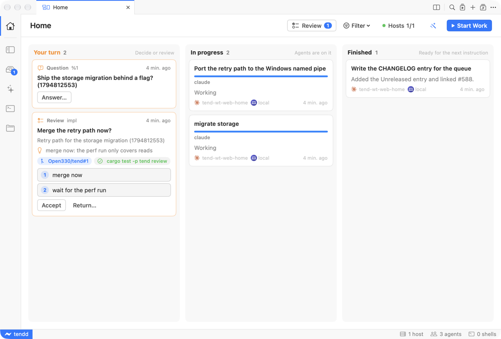 | 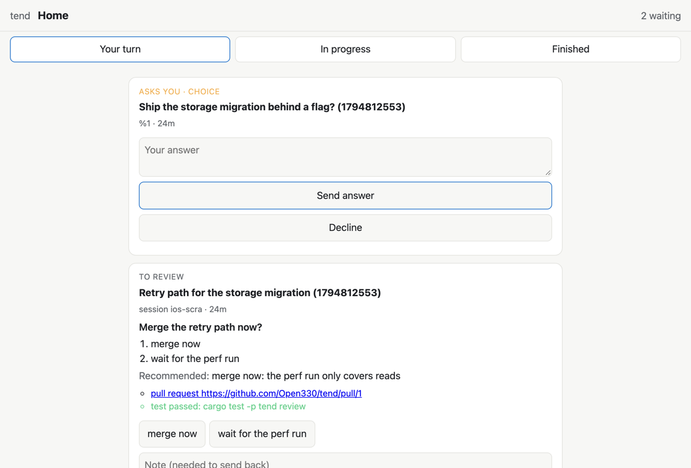 |
| **Tend for Mac (dark)** | **Dashboard `/` before** |
| 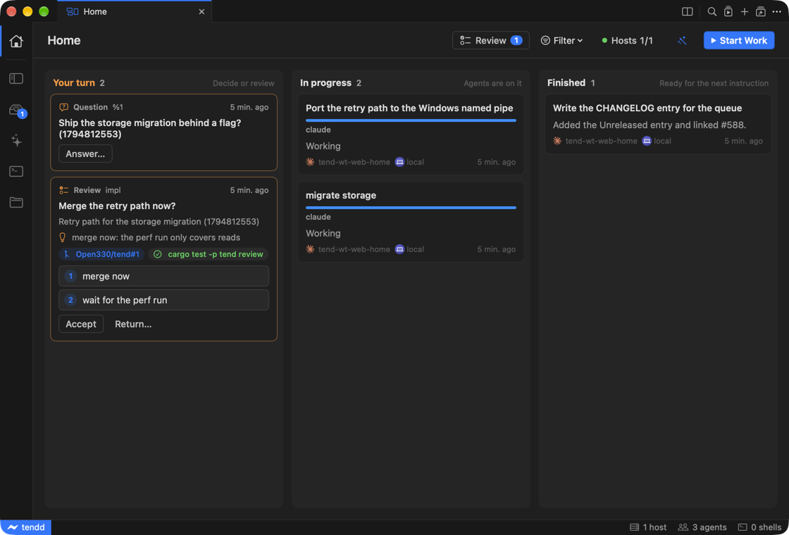 | 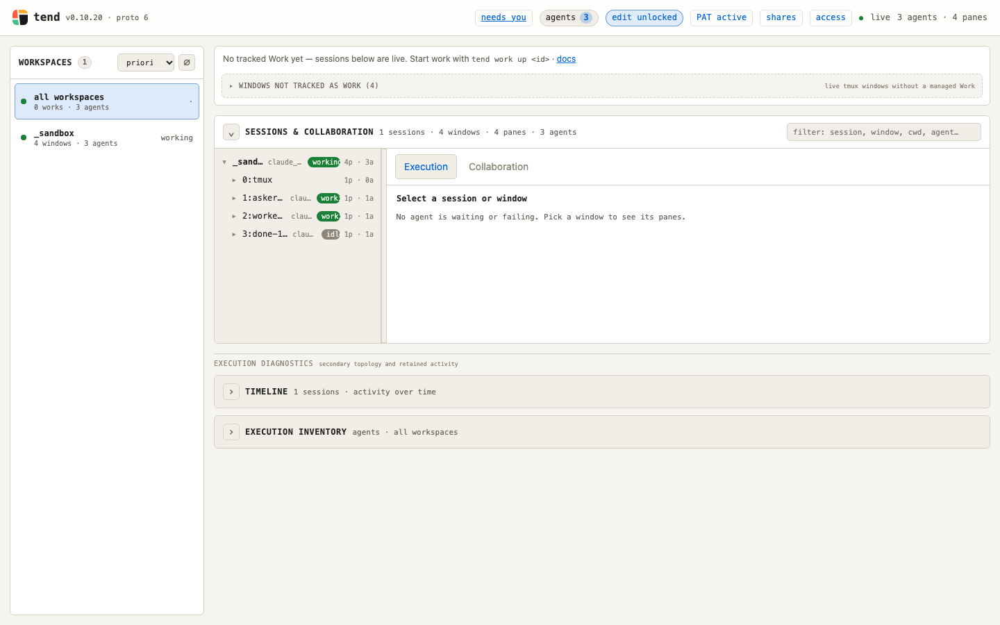 |

### Gap list (before)

| Area | Tend for Mac | Dashboard before |
| --- | --- | --- |
| Shell | Activity rail (Home, Explore, …), tab strip, status bar with the tendd chip, host and agent counts | Two unrelated pages: `/` a workbench with its own top bar, `/home` a bare page with a text "tend" link |
| Layout | Three lanes side by side, each a rounded panel with title, count and subtitle | Three tabs, one column of cards at a time, 46rem wide, on every screen size |
| Header | "Home", Review, Filter (host, project), Hosts n/m with a popover, Automation, Start Work | "Home" and "2 waiting" |
| Words | Your turn / In progress / Finished; Question, Review; Answer…, Other…, Accept, Return…; "Decide or review" | Same lane names, but "ASKS YOU · CHOICE", "TO REVIEW", "Send answer", "Looks good", "Send back", "Withdraw", "Decline" |
| Question card | Kind, asker, time; title; options as numbered rows that fill the composer; Answer… opens a composer with Cancel / Send | Always-open textarea, full-width Send answer and Decline buttons |
| Review card | Checks first, title (the decision needed), summary, recommendation with a bulb, evidence chips (PR, test, commit), options as numbered rows, Accept and Return… | Plain list of options, "Recommended:", links as text bullets, a textarea and three full-width buttons |
| Unit card | Title, stage bar, stage name, headline, footer (agent mark, repo, host disc, relative time), selectable into an inspector; since #587 two layouts (status emphasis with a lane stripe and inset, or a compact list) | Kind label, title, a `·`-joined meta line, "open the pane" link |
| Grouping | By project inside each lane; tend's own asks last | By host |
| Inspector | 400pt panel (docked ≥1040pt, floating below): Now box, reply / Send Back, Open Pane, Stages, Agents | None |
| Tokens | TendTheme.swift: neutral VS Code-like surfaces, system colours, 13/12/11pt type, radii 4–9 | `style.css` and `needs.css`, two more palettes (warm greys, a dark-first page), none shared with the app |
| Mark | Four-room mark lit by state (rule A) | A static icon |
| Security header | — | `/home` had `frame-ancestors 'none'` only |

## Target, as built in phase 1

The Mac's current default is status emphasis (#587); the web follows it, and
has the compact list behind the same two-icon toggle in the header.

| Tend for Mac (main, status emphasis, dark) | Dashboard `/home` after (status emphasis) |
| --- | --- |
| 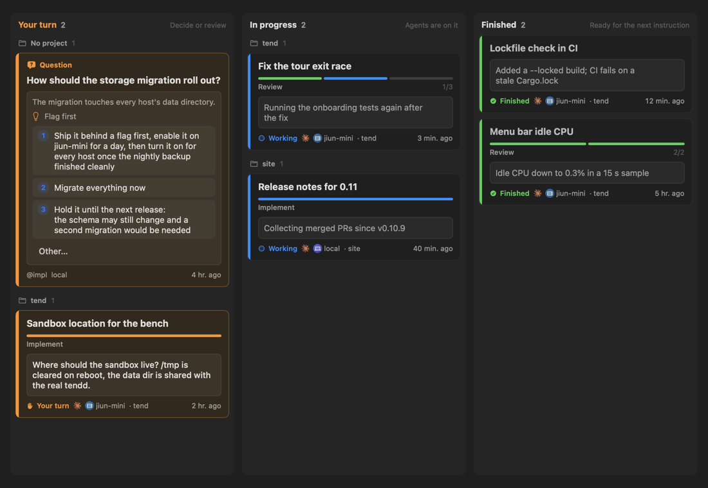 | 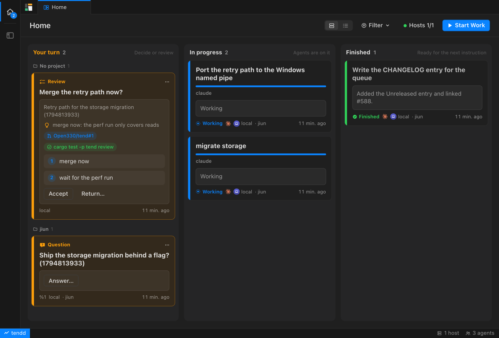 |
| **Tend for Mac (main, compact list, a decision selected)** | **Dashboard after (compact list, a decision selected)** |
| 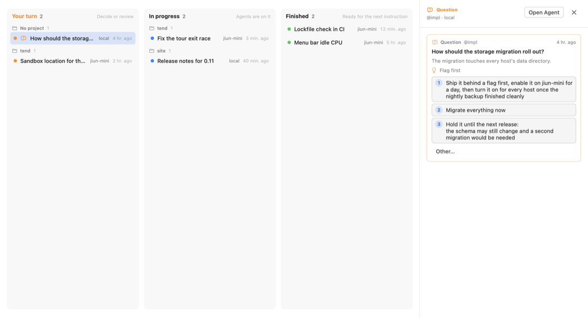 | 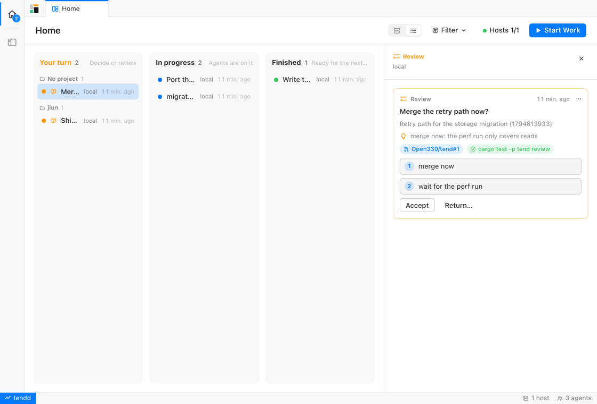 |
| **Tend for Mac v0.10.20 (plain cards; composer open)** | **Dashboard after (light; composer open)** |
| 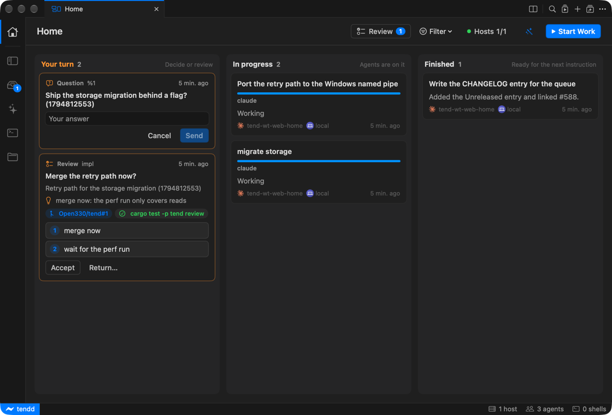 | 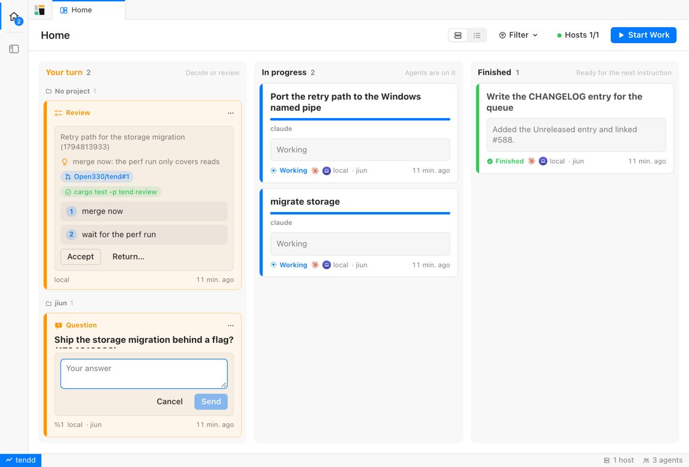 |
| (inspector: same sections, from `FleetHomeView.swift`) | 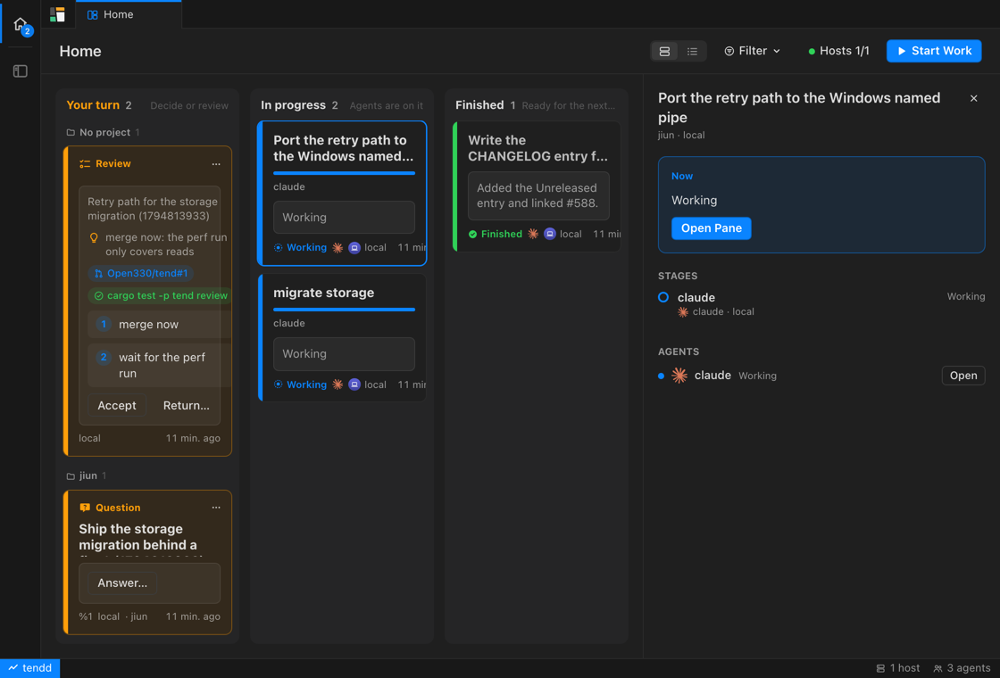 |
|  | 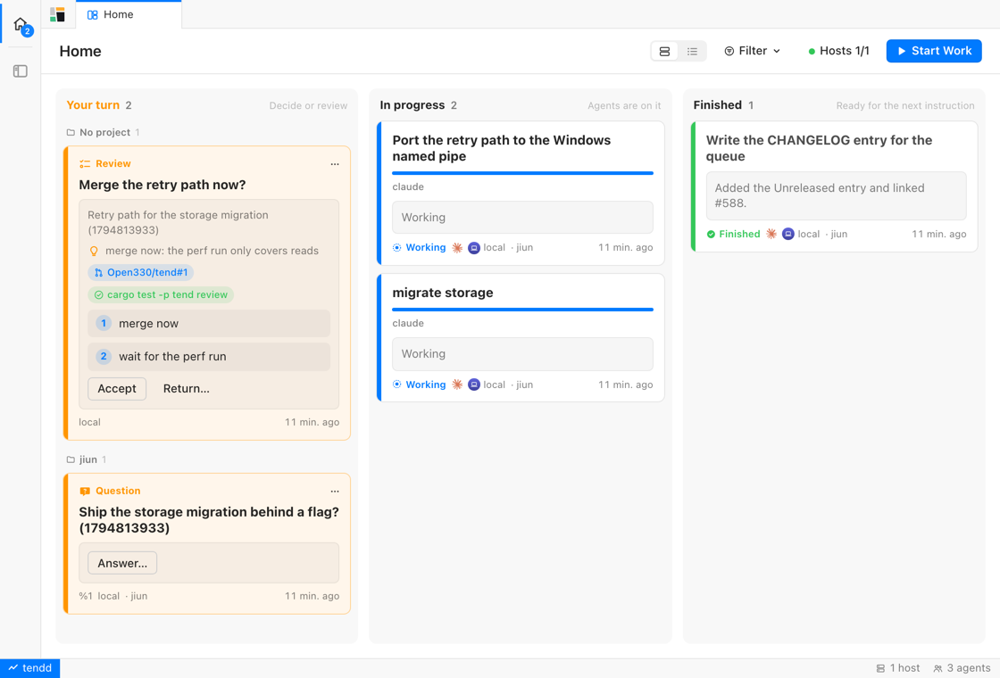 |

Phone (390 pt wide), before and after:

| Before | After, Your turn | After, composer (dark) | After, inspector |
| --- | --- | --- | --- |
| 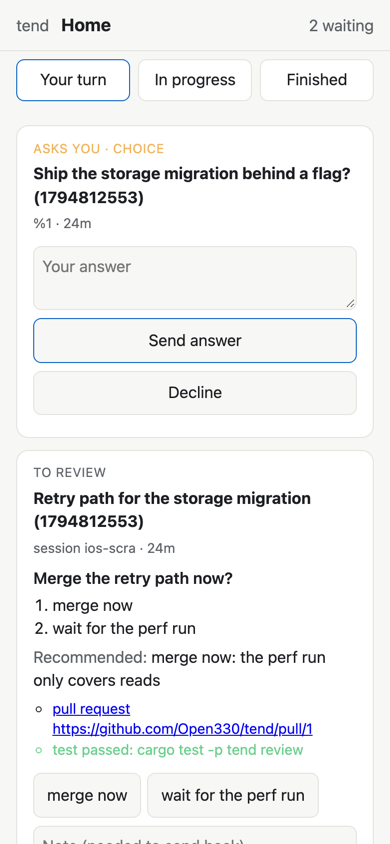 | 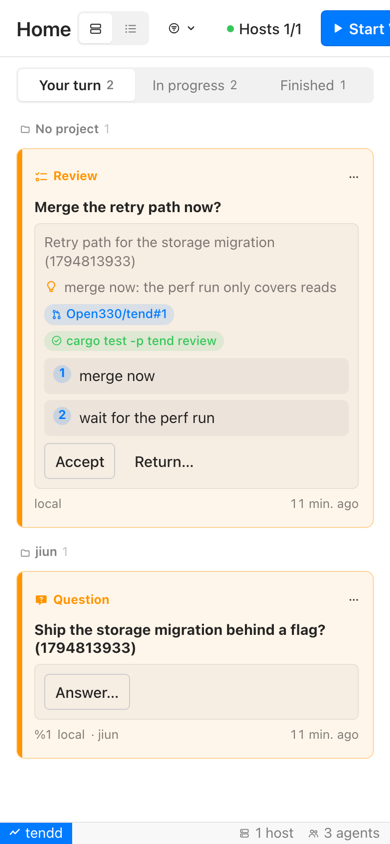 | 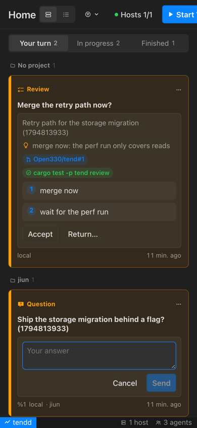 | 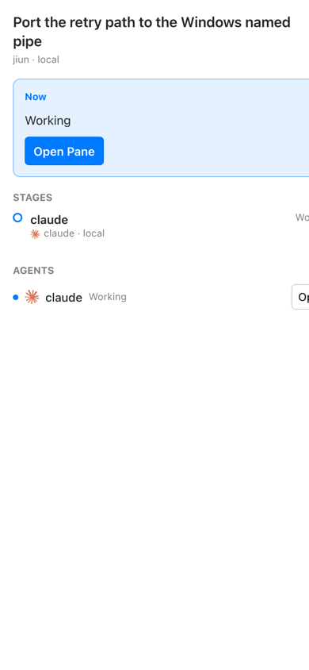 |

### Structure

```
┌────┬──────────────────────────────────────────────────────────────┐
│ ⌂  │ ▣ Home                                          (tab strip)  │
│ ▭  ├──────────────────────────────────────────────────────────────┤
│    │ Home                     ⓕ Filter ⌄   ● Hosts 1/1  ▶ Start Work│
│rail├───────────────┬───────────────┬───────────────┬──────────────┤
│    │ Your turn  2  │ In progress 2 │ Finished  1   │ inspector    │
│    │  project      │               │               │ (≥1040 px    │
│    │  [decision]   │  [unit]       │  [unit]       │  docked,     │
│    │  [unit]       │  [unit]       │  [decided]    │  floats      │
│    │               │               │               │  below)      │
├────┴───────────────┴───────────────┴───────────────┴──────────────┤
│ ⚡ tendd                                     ▤ 1 host  ⚇ 3 agents  │
└───────────────────────────────────────────────────────────────────┘
```

- **Rail**: Home (badge: Your turn count) and Explore (the existing
  workbench at `/`). The Mac's Inbox, Ask, Shells and Files are local to the
  Mac and have no web counterpart yet (below).
- **Tab strip**: the four-room mark where the Mac has its traffic lights,
  lit by rule A from what is on the board (waiting, error, working, done;
  all dimmed while disconnected), and the Home tab.
- **Header**: "Home"; the card-layout toggle (status emphasis / compact
  list, remembered per browser like the Mac's `tend.home.cardLayout`);
  Filter (host, project, Clear Filters); Hosts n/m with
  the popover of hosts and their states; Start Work (a sheet posting
  `/api/work-control/up`; where the host has dashboard starts off, the
  sheet says so).
- **Lanes**: Your turn / In progress / Finished with the Mac's subtitles,
  counts and empty copy; Your turn's title turns orange when it holds
  anything. Units are grouped by project, the group placed where its first
  unit is, tend's own asks last under "From tend itself"; headers only when
  a lane has more than one group. Finished folds items older than a day
  behind "N older".
- **Status emphasis** (default, `FleetHomeCards.swift`): the lane's 5 px
  stripe, a 14.5 px bold title, the question or latest line and the choices
  in an inset box, then one meta line (state, agent mark, host, project,
  time); Your turn cards tinted. **Compact list**: one 30 px row per item
  (status dot, title, host, time); selecting a decision opens its whole
  card beside the board (`FleetDecisionDetail`), a unit opens the inspector.
- **Cards**: the decision card (Question / Review) and the unit card, field
  for field and in the Mac's order (`FleetDecisionCard` in
  `FleetDecisionViews.swift`, the unit card in `FleetHomeView.swift`); a decided card in Finished shows the outcome and who
  decided. Withdraw (and Decline, which the web had and the Mac does not)
  sit in a card's `…` menu, as the Mac keeps Withdraw in a context menu.
- **Inspector**: the Now box (Needs your decision / Now / Last result), the
  reply field (Answer / Send Back, to the agent's pane through
  `/api/panes/{p}/prompt`), Open Pane (the workbench's pane drawer, live
  output and composer), Stages and Agents. Escape closes it.
- **Status bar**: the tendd chip (connected, connecting, disconnected), host
  and agent counts.
- **Phone (< 760 px)**: no rail or tab strip; a segmented control with the
  three lanes and their counts; one lane at a time; the inspector as a
  full-screen sheet; type one step up (body 15, meta 12.5) because 13 pt on
  a phone is below what iOS itself uses; safe-area insets respected.

### Unit rule in phase 1, and what that leaves out

Phase 1 reaches parity of the shell, the words, the cards and the decision
flow; it is not yet parity of the board's content for managed Work, so the
owner's full goal needs phase 2.

Phase 1 draws one agent as one unit with one stage, which is exactly how the
Mac draws an agent that no Work owns, with the Mac's rules for it
(`FleetBoard.work(for:)`): the AI title, else the prompt as a title (tend's
delivery notices and background-task blocks read as what they are), else
"claude on host"; the recap, else the last response, as its line; the
pane's current path before the recorded cwd for its project. The Mac also groups agents of one Work
into a single multi-stage unit, folds helper sessions, and shows a Backlog
lane. Re-implementing `FleetBoard` (about 860 lines of Swift) a second time
in JavaScript would recreate the drift this stream exists to remove, and
the Windows proposal already planned the alternative: a daemon-side board
read (`home_board`) that classifies once and that every client lays out.
That is phase 2. Rate limits are the other known divergence: the Mac
moves an agent at an uncovered usage cap to Your turn and marks a covered
one "the limit policy will resume it", which needs the limit-policy
coverage only the Mac computes today. The web shows such an agent by its
raw state until the board read carries the coverage.

## What the web cannot carry, and what replaces it

| Mac | Why not on the web | Web instead |
| --- | --- | --- |
| Open Pane (a native terminal tab) | No local terminal | Open Pane opens the workbench's pane drawer: live output (operators only) and a composer |
| Choice on screen (reads the pane's numbered dialog, sends arrow keys) | Screen parsing is a fallback, not a source to act on from a remote page (DIRECTION: deterministic first) | "Answer in Pane" / the reply field; the question itself comes from the deterministic decision queue |
| Always Approve This Command… | Writes the Mac's local approval rules | Not offered |
| Inbox, Ask, Shells, Files rail items | Local Mac features | Not on the rail |
| Review sheet (⇧⌘R) and "Looks Good" on a finished unit | Its reviewed marks are app-local, or a tendd record the web has no route for yet | Phase 2 with the board read |
| Automation (wand) | No dashboard route reports the policy state | Phase 2 |
| Menu bar, notifications, global hot key | Browser | The Windows app's toasts, the iOS proposal's push; the page title carries the Your turn count |

## Design tokens: one source

`apps/shared/Design/tokens.json` holds the colours (both schemes, with the
`TendTheme` function each mirrors), state colours, the brand rooms, host
identity gradients, font stacks, type sizes and metrics.

- The dashboard consumes `crates/tend/src/dashboard/web/tokens.css`,
  generated by `node scripts/design-tokens.mjs` and committed, so tendd
  serves it as a file and nobody who builds tend runs a generator.
- `crates/tend/tests-js/design-tokens.test.mjs` (in the existing CI
  `js-test` job) fails when `tokens.css` is stale **or when TendTheme.swift
  or BrandMark.swift no longer draw what tokens.json says** for the values
  it checks: the surfaces, the brand rooms' sRGB components and the shell
  metrics. A checked colour changed on one side fails CI until the other
  side follows. Type sizes, card metrics (`FleetHomeCards.swift`), host
  gradients and the state-to-colour map are in tokens.json but not yet
  checked against Swift, so they can still drift until phase 4 generates
  the Swift side; that phase is what makes the guarantee complete.
- The Mac app is not edited in phase 1 (other sessions are changing Home).
  Phase 4 (done) generates the Swift side from the same file:
  `apps/shared/Sources/TendDesignTokens.swift`, compiled into Tend for Mac
  and the iOS app. `TendTheme`'s surfaces and shell metrics read it (a
  mechanical change), and the test checks both generated files are current
  and that `TendTheme` reads the tokens. Type sizes, card metrics and host
  gradients are generated too, for the views that adopt them next.
- Agent marks: the Claude and OpenAI marks are the files Tend for Mac ships
  (`Assets.xcassets/AgentLogos`, sources in `AgentLogos-NOTICE.md`), drawn
  only scaled; the OpenAI mark only in black or white.

## Constraints kept

- **Served by tendd, no build step**: plain ES modules and CSS embedded with
  `rust-embed`, as before. The only generator (tokens) runs at authoring time
  and its output is committed.
- **No CDN, no web fonts**: system font stacks (SF on Apple, Segoe UI on
  Windows, Apple SD Gothic Neo / Malgun Gothic for Korean). Icons are small
  SVG files used as CSS masks.
- **Weight**: Home now loads about 135 KB uncompressed (home.mjs 41 KB,
  home.css 29 KB, home-board.mjs 16 KB, home-strings.mjs 8 KB, tokens 4 KB,
  the shared needs-model / fleet-view / pane-drawer modules 34 KB) plus
  15 KB of icons, against about 59 KB for the page it replaces; tendd
  serves it uncompressed from memory, so this is also the wire size on a
  first load (later loads revalidate with `no-cache`). No framework; one
  poll of four reads every 5 s while the page is visible (the Mac's decision
  poll interval), none while hidden.
- **CSP**: `/home` and `/needs` now send `default-src 'self'; script-src
  'self'; style-src 'self'; img-src 'self' data:; font-src 'self';
  connect-src 'self'; frame-ancestors 'none'; base-uri 'none'; form-action
  'self'; object-src 'none'` (the page has no inline script or style; a
  server test checks both), plus `X-Frame-Options: DENY` as before.
- **Credentials**: the token arrives in the fragment (`/home#token=…`),
  moves into `localStorage` and out of the address bar, or never reaches the
  page when a proxy holds it (the Windows app adds `Authorization` itself;
  the page then simply sends no header). The OIDC session cookie works as
  before, with `X-Tend-Operator: 1` on every write.
- **Paired devices and proxies**: only the decision routes accept a paired
  device's credential (the Fleet read answers it 401), and the Windows app
  forwards only Home's routes (the others answer 403). So a refused
  `/api/fleet` or `/api/access` leaves those parts empty and does not sign
  the page out; only a refused decision queue (401/403) counts as lost
  access, and a session that ended fails that read too. Explore and the pane
  links lead to the workbench, so they show only where `/api/access`
  answers (not behind the Windows proxy, not for a paired device).
- **Narrowed or lost access**: when a read that used to answer is refused,
  what came from it leaves the page at once, even under a draft being typed.
  On a lost sign-in nothing private stays: cards, the details panel,
  drafts, host names, filter options, open menus and the Start Work sheet
  are cleared, and the sign-in link returns to `/home#item=…`. The page
  polls one batch at a time, each read bounded to 8 s, so a slow host
  delays the next poll instead of overtaking it.
- **Agent text** is set with `textContent` only; evidence links only for
  `http(s)` URLs.
- **iOS app**: unaffected; it uses the API, not the page.
- **Accessibility**: real buttons and links throughout (cards that open the
  inspector are `<button>`s with `aria-expanded`), the segmented control is a
  `tablist`, status lines are `role=status`, focus rings on every control,
  colour is never the only signal (counts, words and icons carry the state),
  and both colour schemes follow `prefers-color-scheme`.

## Phases

1. **Home at parity** (this stream, now): tokens, shell, lanes, cards,
   inspector, reply / Send Back, Start Work, filter, hosts, phone layout,
   English and Korean, strict CSP; JS unit tests for the board and the page
   and a browser end-to-end (`scripts/dashboard-home-e2e.mjs`: answer →
   decide → Finished, desktop with status emphasis and phone with the
   compact list, no CSP errors).
2. **One board for every client**: a `home_board` read in tendd (behind a
   capability string) that does Work grouping, stages, helper folding,
   Backlog and reviewed marks once; the web, the Windows app and the iOS app
   lay it out, the Mac app can follow. Brings the Review sheet, "Looks
   Good", Backlog and the automation state to the web.
3. **The rest of the shell**: Explore (sessions, panes, the pane viewer)
   rebuilt in the shell from today's workbench, hosts and agents pages,
   settings and access administration as shell pages; then decision 1 (`/`
   opens Home).
4. **Generated Swift tokens**: the Mac (and iOS) read the same tokens.json
   through a generated Swift file in `apps/shared`.

## Verification in phase 1

- `node --test crates/tend/tests-js/*.test.mjs`: the board model against the
  daemon's recorded fixtures (`apps/shared/Fixtures`), the page module under
  a fake DOM (token scrub, lanes, the audited answer route with the operator
  header, a refused optional read, a lost sign-in), the token drift check.
- `cargo test -p tend --lib dashboard::` (Home's CSP and routes).
- `scripts/dashboard-home-e2e.mjs` against a scratch tendd
  (`apps/tend-ios/Scripts/scratch-tendd.sh`), desktop and phone.
- Screenshots above, beside the Mac app on the same data.

## Wave 7: closing the gaps to Tend for Mac

| Item | Done in | State |
|---|---|---|
| Review sheet: Digest, Cards and Inbox; Later; Send Back; the Mac's keys | #629 | At parity, with the exceptions below |
| Explore: the Mac's four orders and its search | #627 | At parity, with the exceptions below |
| `/workbench` leftovers: what moves, what stays | #631, this section | Collaboration moved; the rest stays, with reasons |
| Route matrix for every Home route | #626, #629, #631 | Covered |
| Screenshots | `web-home/w7-*` | Web only; see *Screenshots* |

### Review (FleetReviewView)

The sheet has the Mac's three modes:
- **Digest**, the default: grouped by project. Each result has a checkbox and can be expanded. Each project has Mark Project Reviewed, and the selection has Mark Reviewed.
- **Cards**: one result at a time, "1 of N".
- **Inbox**: a list, J/K to move, and Mark All Reviewed… with an inline confirmation.

Each mode shows Asked (the Mac's digest of the prompt) and the Agent's report, rendered as Markdown with DOM nodes, never markup. Each ends in Looks Good (E/L), Later (H), Send Back (R) or Open (O). Later moves a result to the end while the sheet is open. Send Back is the inspector's reply, sharing its draft and target check. The keys leave text fields and radios alone; a focused button or link keeps its arrows, Space and Return, while the letter keys still act.

The board carries `review.asked` and `review.result` only for results still to review. After a successful pane send, Home records the answer or Send Back, best effort, through `POST /api/home/instruction`, as the Mac does: a `returned` review under `home-answer:` or `home-sendback:`. A failed record never resends the words. Before this, the web recorded none of them.

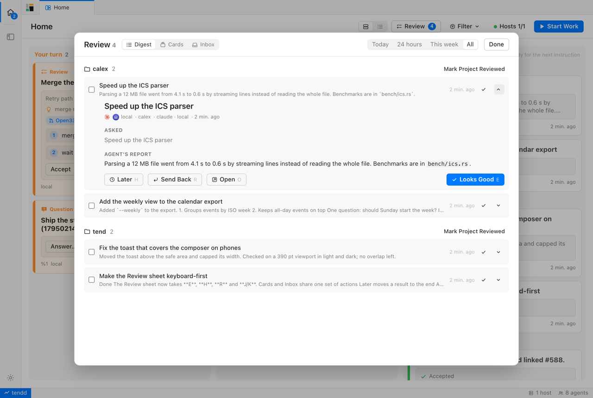
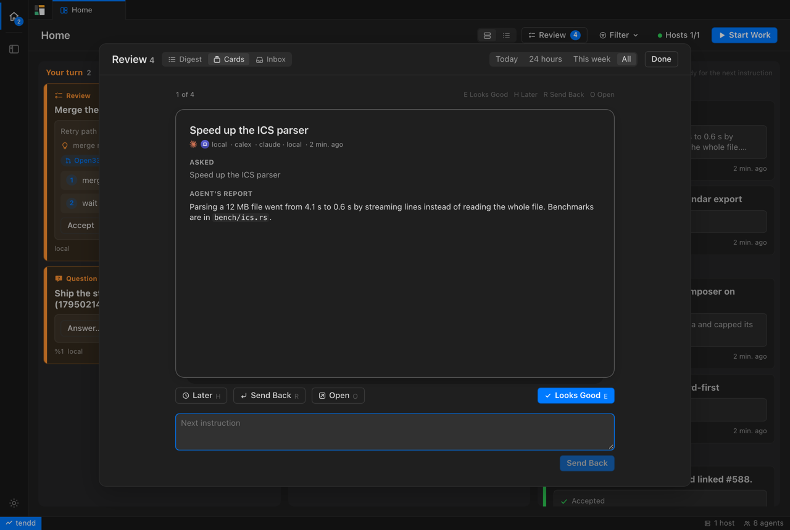
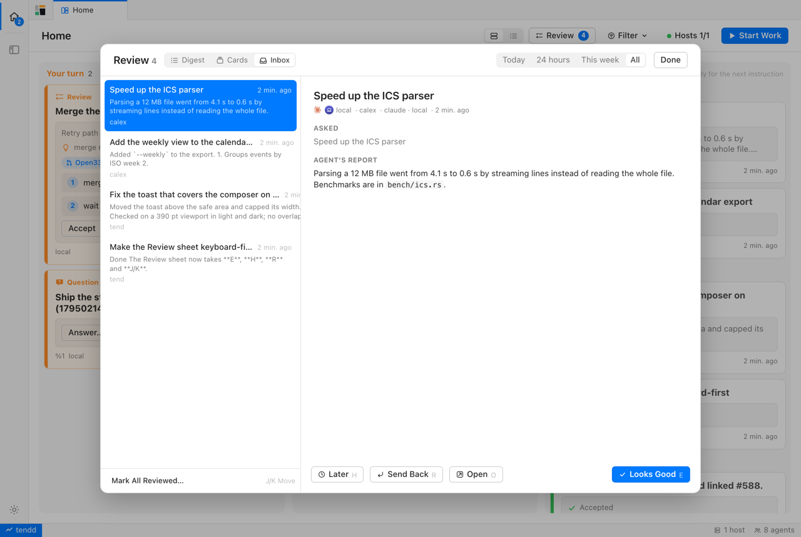
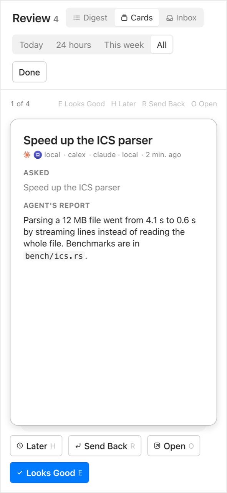 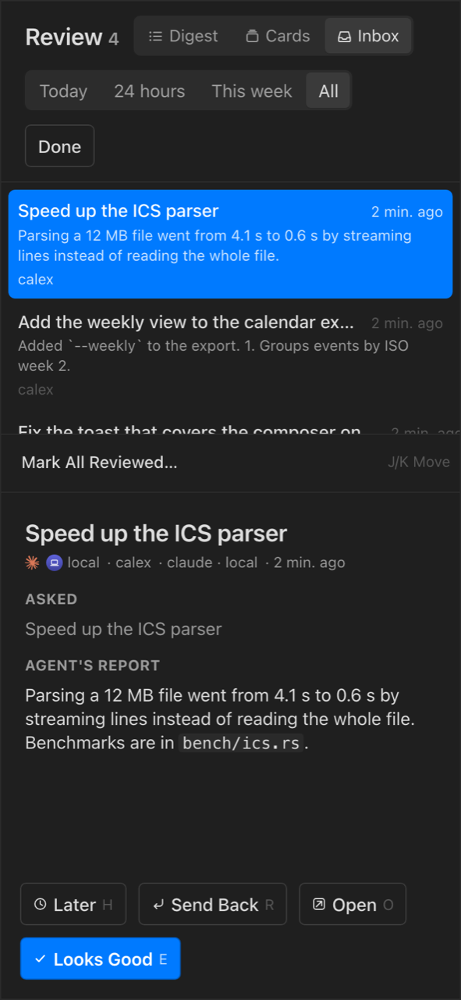

### Explore (SidebarViews)

- **Orders**: Topology (the default), Latest activity, My latest prompt and Agent latest update, with the Mac's tie-breaks. The choice is kept per browser.
- **Search**: matches host, session, window, pane id, command, path, agent alias, title and session id. A session-name match keeps the session's panes.
- **Active**: shows working panes only, as on the Mac.

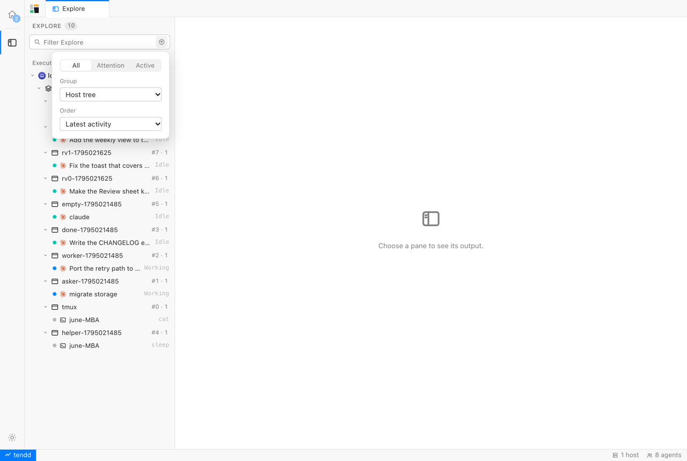
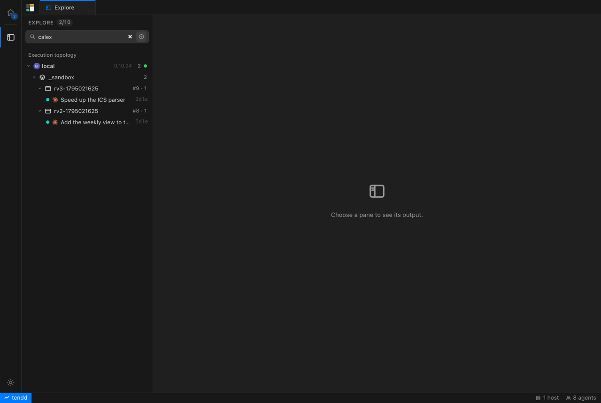

### `/workbench`, decided with the reviewer

| Workbench part | Verdict | Why |
|---|---|---|
| Collaboration (Messages / Graph / Sequence, history, filters, links) | **Moved** to Explore → Messages (`/explore/messages`) | The broadest view of peer threads; the Mac has a narrower one (OperatorInbox's TendCollaborationView). `#message=` and `#thread=` links redirect for operators; mixed links stay. |
| Timeline (activity heatmap and lanes) | **Stays** at `/workbench` as advanced Activity | A different dataset from Review → History; the Mac has none; the CLI has `tend timeline`. |
| Terminals tab | **Stays** | Tend-owned terminal sessions are not multiplexer panes; Explore does not list them yet. |
| Classic Work board, Work inspector, start form | **Stays** | Moving them first needs Start Work for any Work and a Work detail on Home. |
| Session navigator, Agents and Panes tables, overview strip | **Stays** for now | Retiring them waits on Explore's session/window detail and the model/context columns. |
| Visitor landing, read-only pane drawer, Share | **Stays** | Non-operators would lose their read-only view; no blanket redirect. |

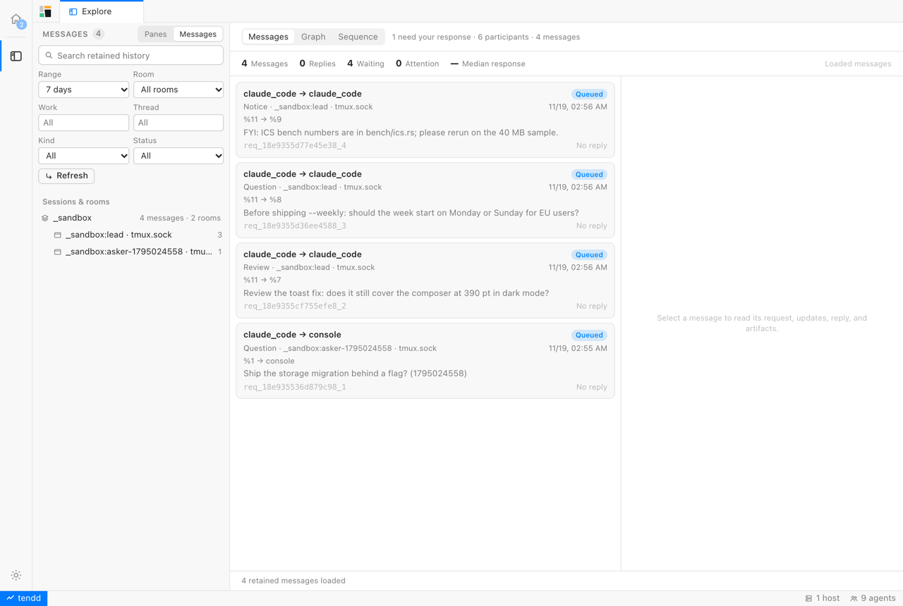
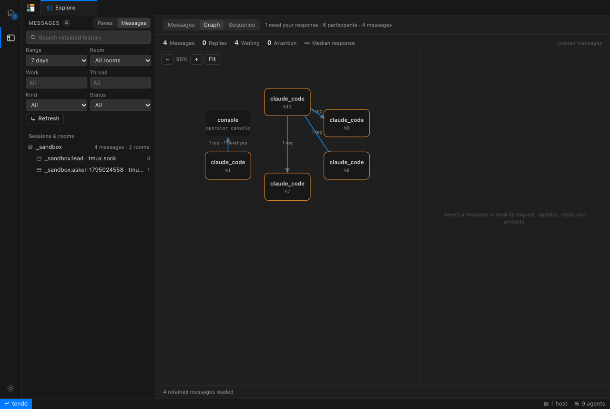
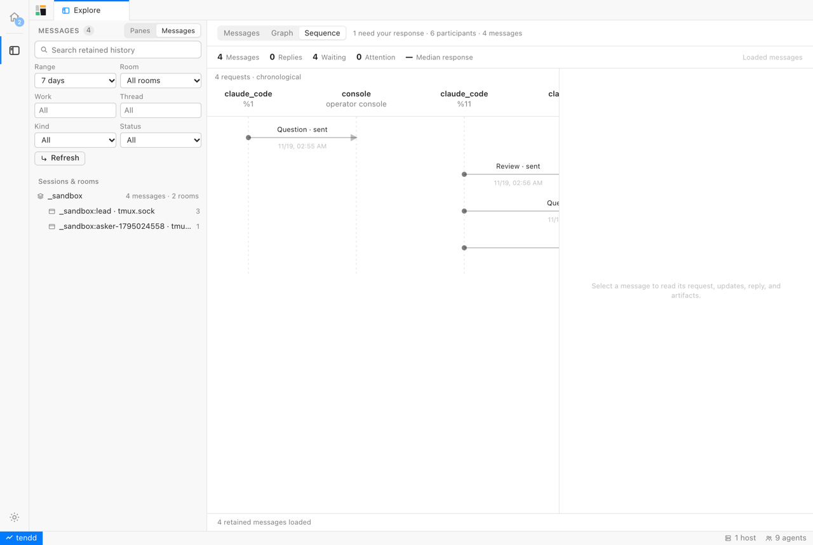

Nothing was retired in this wave. Every old link still opens where it did, or redirects to the moved reader.

### Still different from the Mac, and why

- **Review**:
  - No Summarize and no Reply to All / Reply to N: they need tend's Ask provider, which has no web route yet.
  - No Decisions section or History toggle in the sheet: Home's Your turn and Finished lanes carry them.
  - No Recorded commands, because turn evidence has no web route yet.
  - No swipe gestures.
  - Digests are cut by code point, where Swift cuts by grapheme.
  - The board cuts `review.result` at 4,000 characters (`result_truncated`, "the rest is in the pane"), so the polled board stays bounded; the Mac shows the whole response.
  - The report's Markdown is a small DOM-only subset (headings, lists, code blocks, inline code, bold): no links, emphasis or tables.
- **Explore**: needing attention is the board's one rule (wave 8): the web takes each agent's `needs_attention` from tendd's board, which applies the limit policies' coverage as the Mac does, and an agent that asked groups as idle, as on the Mac. Messages reads this daemon's history; a link naming another Fleet host points to that host's dashboard instead of being read here. Collation is the browser's numeric `Intl.Collator`, not `localizedStandardCompare`.
- **Workbench**: the rows marked *Stays* above.

### Screenshots

The web shots are taken against a scratch tendd: light and dark, desktop and phone. The Mac shots beside them could not be taken in this wave, because this Mac's screen was locked for the whole session, and a locked screen shows no app window. The earlier Mac references in this folder (`mac-*.png`) still show Home and Explore.

Wave 8 adds the Mac side, from a separate-bundle build (`dev.tend.audit.wave8`, its own preferences) on the demo fixture's sandboxed tendd. These are the same fleet the landing page's shots show, not the scratch daemon behind the web shots above:

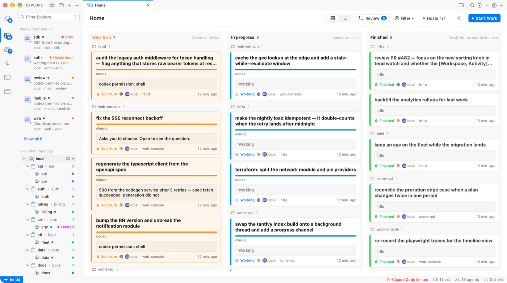
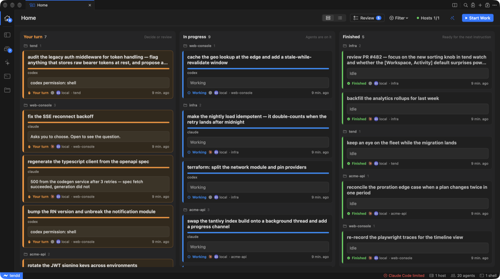
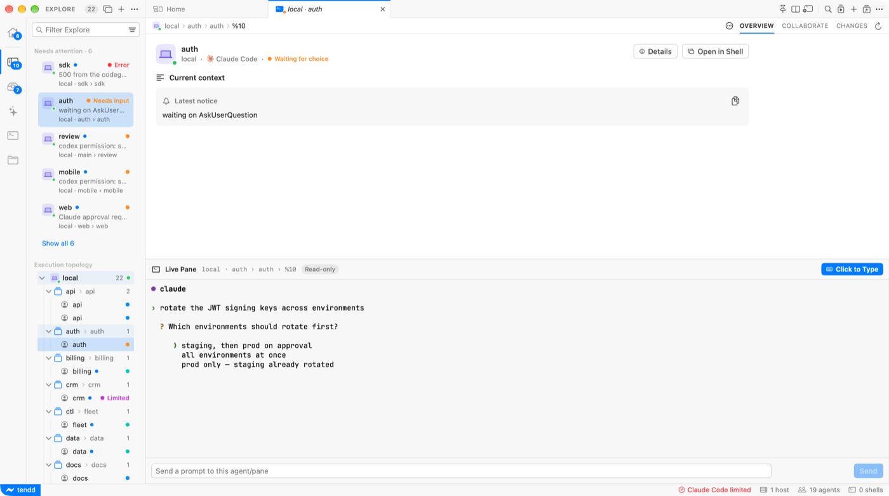
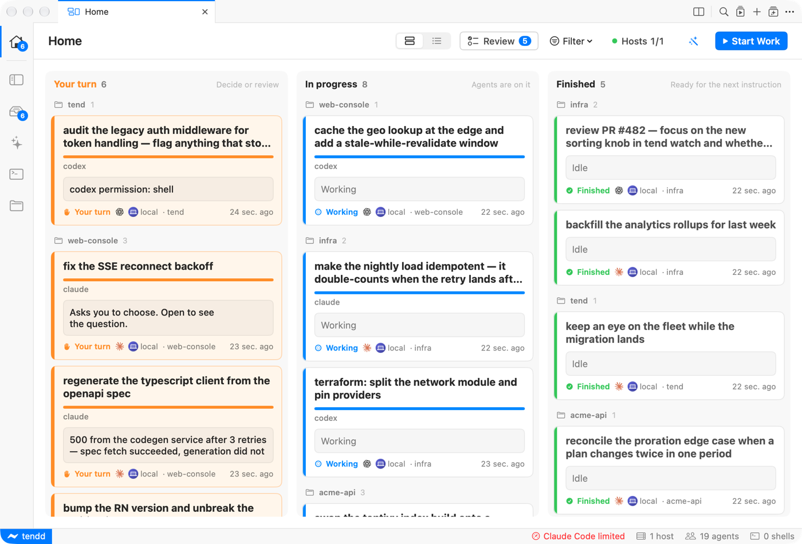

The Mac's Review sheet could not be captured: the capture tool takes the window, not a sheet over it.
